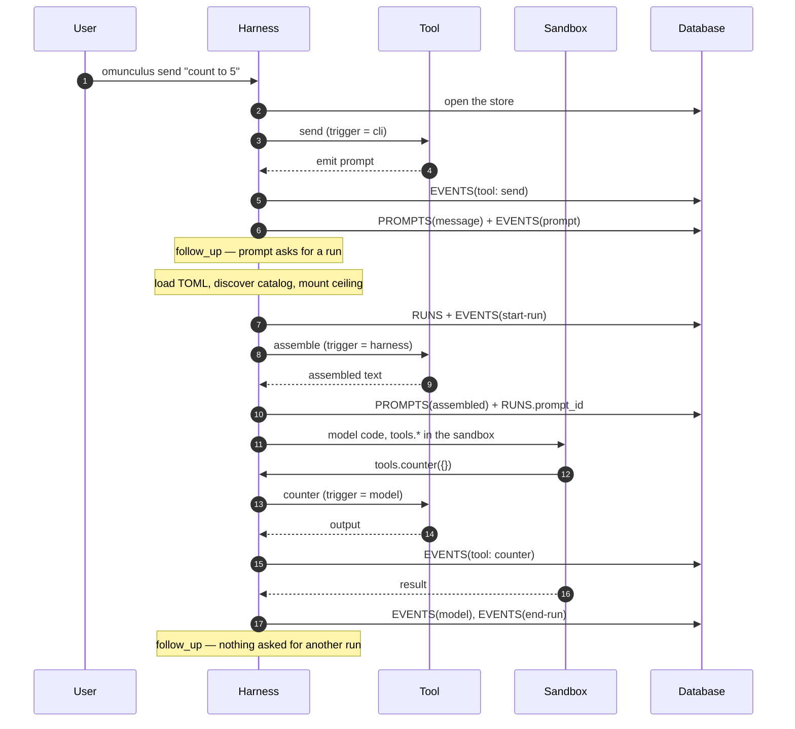

# The cycle

The spine is `EVENTS`. A work continues from the work row and its last
comment, not from a replay of the log. The harness records; it does not
reconstruct a work from history.

```text
event
    → emit → the store applies the action
    → hooks of that event run in the unroll, with the run open (not those of end)
    → a call that did not end the run: if its actions asked for a run
      (prompt, work, continue, break, delegate, cancel, request, reply),
      that run opens now, while this one goes on
    → end, or the model stopping by itself: EVENTS(end-run) of this run
    → if an action of the ending call asked for a run
        → open the next run (agent and ceiling from the TOML, now)
    → hooks of end (they see this run closed; the next runs are due and
      may already be running)
    → reaction runs of hooks with an agent
    → if the model stopped by itself on a work still open: a retry run of
      that work, or, once max_retries is used up, a break (a child) or a
      request to the person (a root)
```

`end` is the only action that ends a run. `delegate`, `request`,
`continue`, `break`, `reply`, `grant`, `cancel` and `work` change the
store and the run goes on; the runs they asked for open at once, or,
when the same call ends the run, once it has closed. A tool can chain `end`:
`done` comments its report on the run's work, continues it and ends the
run in one call; `work` comments its report on the run's work, delegates
each new work below it and ends the run, or, in a run without a work,
creates the root work and ends the run; `break` parks the work with its
report and ends the run; `request_access` and `request_sandbox` comment
their report on the run's work, open the request and end the run. The
model reaches `continue` only through `done`.

A hook is a tool fired by an event: same contract, any `emit`. Who opens
the next run of a work is the action. A hook can open a run too if its
manifest has `agent`, or if it emits one of those actions. Cascades are
the author's.

## Four texts, and a fifth

| Piece | Who writes it | Where it lives |
| --- | --- | --- |
| **message** | you, via `send` | `PROMPTS` (`kind = message`) |
| **agent text** | whoever edits the TOML | the file |
| **title** | whoever created the work | `WORKS.title` |
| **goal** | whoever created the work, required by `work` and `delegate` | `WORKS.goal` |
| **assembled** | the `assemble` tool, at the opening of a run | `PROMPTS` (`kind = assembled`) |

`send` does not create a work and does not copy the message onto the title.

## Opening a run

```text
omunculus send "count to 5"
    emit prompt → PROMPTS(message) + EVENTS(prompt)
    open run → EVENTS(start-run) (prompt_id still empty)
    harness dispatches assemble (name in agents.<x>.assemble or [policy] assemble)
    non-empty output → PROMPTS(assembled) + RUNS.prompt_id
    the model sees the assembled and calls through code in the sandbox
each tool
    chained steps: out.chain, then the manifest's then, each an EVENTS(tool)
      with via = the tool that chained it; a refused step writes none of them
    EVENTS(tool) — name, args, result
    emit → the store applies the action, for the tool and its steps in one go
    hooks of those events, still in the unroll
    if end: nothing after it in this run executes
    no end: the runs its actions asked for open now
close (end, or the model stopped)
    EVENTS(end-run), status = done
    next runs the ending call's actions asked for, then hooks of end,
      then reaction runs of hooks with an agent
    the model stopped by itself on a work still open: retry, break, or a
      request to the person
```

The TOML is read again at this opening. `RUNS.tools` is a snapshot of the
effective set, not a cache the next run will reuse. Without the assemble
tool named, the opening fails. An empty assemble output fails. The next
run does not reread the old assembled prompt; assemble runs again.

`via` on the run is the `name` of the tool or hook that opened it
(`send`, `continue`, `delegate`, `reply`, `on-request`, …), or `retry`.

## Runs at once

Every run opens in a process of its own, so the runs one command asks
for run concurrently: the children of one `work` call, a parent reopened
by a child, a reply, a retry. At most `[execution] max_concurrent` are
open at once; the rest wait in the queue (`max_queue`,
`queue_timeout_ms`). The command returns once every run it opened,
directly or through other runs, has finished, and fails with the error
of any of them, several one per line.

A work has one run at a time. A run due for a work that has a run open
waits until that run finishes, and the waiting runs of a work open in
the order they became due. A run of the work's own (not a named agent's)
due while another is already waiting is the same run, and opens once.
A work's own run that would begin when the work is no longer open —
done, waiting, cancelled — does not open; a named agent's run does not
open on a cancelled work. The run of `send`, which has no work, holds the
turn of the root it creates from then on: when it goes on after `work`
(`then = []`), the root's run opens once it has finished.

When a layer sets `then = []` on `work`, the run goes on after
delegating: the children's runs open while it runs. The work waits on
its children, and its run may still `comment`, `work` (delegate more)
and `end`; `done` (its `continue`), `break` and a request are refused
while it waits on them. The parent's next run opens once no child is
open, after the run that delegated has finished.

The store has one connection, owned by one process. Every transaction
runs there whole, one after another, so a decision the store reads and
writes — the last child closing wakes its parent, a request's arbiter, a
reply to a request still open, the retry count of a work — is taken once,
whatever the order the runs reach it. Permanent grants rewrite the TOML
one at a time, replacing the file whole.

## A run without a report

A run whose model stops by itself, without `end`, leaves its work as it
was. If the run was on a work and that work is still `open`, the harness
opens another run of the same work with `via = retry`. The retries of a
work are its most recent closed runs, in a row, without `end`, minus the
first; a run that ends with `end` starts the count over. Once the retries
reach `max_retries` (`[policy]`, or the work's workspace), the harness
does not open another run. A work with a parent gets `break` with the
comment `The work stopped without a report after N runs.`, which parks it
and wakes the parent waiting on it, whose run opens. A root work gets a
request to the person instead, opened by the harness with that sentence
as its reason and the options `retry` (no call) and `cancel`, and an
inbox entry that names the request; the work waits on it. `reply --option retry`
opens another run of the work; `reply --option cancel` cancels it. The
run opened by `send` has no work and is never retried; a run
opened for a named agent (a hook's `agent`, a request's arbiter) is not
retried either; nor is a work left `waiting` or `done` by its run.

## Assemble

The default `assemble` tool joins, in this order:

```text
agent text
→ message of this opening, if any
→ if there is a work: title + goal + last comment, then, under
  `## Last run`, the work's last closed run; without a work, the run that
  opened this run's request: the message that opened it and every event
  it recorded but the calls of assemble and its start and end, that is
  the model's messages as recorded but their `usage`, each tool call
  with its args, status and output, and each store action it emitted
→ if there is a request: header, its options with their tool calls, and
  the comments with that request_id
→ if the opening carried inbox_id: comments with that inbox_id
→ if the run has the work card: the agents a new work may name
→ cards of the tools in tools.*
```

Inbox does not appear because the work has unread notifications. Without
`inbox_id` on the opening there is no `## Inbox`. Unread notifications of
a work, if wanted in the prompt, are the `output` of the `inbox` tool.

A card is:

```text
- name: description (≤3 lines) [tags: a, b]
```

No tags, no suffix. What becomes a card is `pinned` ∩ effective. The rest
of the effective set is reached through `tool_search`. Without `pinned` on
a layer, every effective tool is a card. Without `tool_search` in the
effective set, `pinned` is ignored and everything is a card. The `catalog`
view `tool_search` searches is the whole effective set.

There is no `message` section when the opening came from `continue`,
`break`, `delegate`, `cancel`, `request` or `reply`.

The model's final text does not reach the terminal. It is `EVENTS(model)`.
`omunculus prompt` prints the assembled prompt, not that text.

## Work

```text
open:     action work (root) or delegate (child); stage = first of the TOML
open → waiting:  break, request (waiting = request, waiting_for = the request), or delegate (waiting = child)
waiting → open:    reply to the request it waits on, all its children done or cancelled, or a child on break — same stage
waiting → open:    send / prompt on a waiting work — reopened_by_prompt
open → open:       continue (chained by done) — next stage, new run
open → done:       continue on the last stage, or with no workflow at its depth
open / waiting → cancelled: cancel, an option of a request
```

`break` parks the work with its report as the comment. It does not
advance the sequence.
`continue` that closes a work, `cancel` and `break` hand it back to a
parent waiting on its children: a `break` reopens the parent at once, a
closing `continue` or a `cancel` once each of the parent's children is
done or cancelled. The event that reopened the parent carries its
`parent_id`, and the parent's next run opens. A root work is only closed,
parked or cancelled. A cancelled work never opens a run again.
`continue` does not name a stage, an agent or a model — the TOML does.

## Request and inbox

A decision goes through `REQUESTS`. A `request` carries a `reason` and
named `options`, each a list of tool calls (`{name, args}`, the shape of
a chain); an option may list none. The model calls `request_access`
(`kind` = `tool` | `path` | `directory`) or `request_sandbox` (`kind` =
`resource`, `name` = `sandbox.write` | `sandbox.network`), each with a
`report`; both offer one `grant_<scope>` per permanent scope and `deny`,
and, in a run on a work, `grant`, which grants on that work. In a run on
a work the report is commented on it first, then the request. Options made only of `grant` calls whose names are all have are
not a request: no row opens, and a tool that emits `request` without
ending the run gets `already granted: <name>` in its output. A granted
name that is blocked is `EVENTS(deny)`. Otherwise a request opens, its
reason the first comment on it; if a work is attached it becomes
`waiting = request`. [The ceiling](ceiling.md) says who the arbiter is.
Both request tools end the asking run; an agent arbiter's run opens on
the parent work after it closes.

`reply` picks an option: the person always may, an agent only as the
arbiter. The request closes, the reply's body is commented on it, and
the option's calls run as steps `reply` chains — under the arbiter's
ceiling, in the reply's transaction, each an `EVENTS(tool)` with
`via = reply`. The builtin `reply` chains `grant` and `cancel`;
a call outside that list fails the reply and writes nothing. The
requester's work, if it still waits on the request, is reopened; if it
is open once the calls applied, its next run opens with the request
thread in its prompt. `cancel` leaves it cancelled, so no run opens. A
request from a run without a work has nowhere to wait: the reply opens
a run of that run's agent in its conversation, with the request thread
and the asking run in its prompt.

`INBOX` notifies and does not wait. It does not park a run or a work.

## The tables

Seven of them: `PROMPTS`, `EVENTS`, `RUNS`, `COMMENTS`, `WORKS`,
`REQUESTS`, `INBOX`. `EVENTS.comment_id` is a weak pointer — no foreign
key — so `compact` can delete comments without taking the event with it.
`EVENTS` is append-only. `REQUESTS.options` does not change after create.
Tools never open SQLite; they `emit`, and the store applies or refuses
the batch.

## One send, followed through


