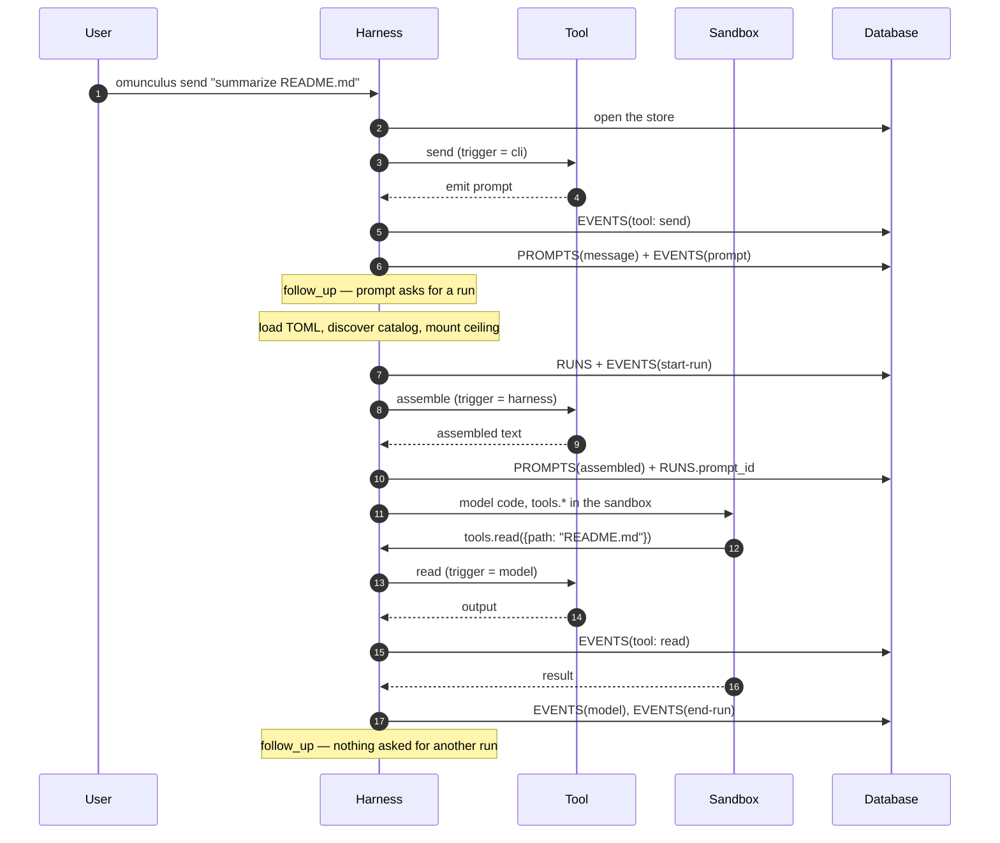

# The cycle

The spine is `EVENTS`. A work continues from the work row and its last
comment, not from a replay of the log. The harness records; it does not
reconstruct a work from history.

```text
event
    → emit → the store applies the action
    → hooks of that event run in the unroll, with the run open (not those of end)
    → a call that did not end the run: if its actions asked for a run
      (prompt, work, continue, break, delegate, reopen, cancel, request, reply),
      that run opens now, while this one goes on
    → end, or the model stopping by itself or failing: EVENTS(end-run) of
      this run, with the failure's reason as its error
    → if an action of the ending call asked for a run
        → open the next run (agent and ceiling from the TOML, now)
    → hooks of end (they see this run closed; the next runs are due and
      may already be running)
    → reaction runs of hooks with an agent
    → if the model stopped by itself or failed on a work still open: a retry run of
      that work, or, once max_retries is used up, a break (a child) or a
      request to the conversation's requester (a root)
```

`end` is the only action that ends a run. `delegate`, `request`,
`continue`, `break`, `reply`, `grant`, `cancel` and `work` change the
store and the run goes on; the runs they asked for open at once, or,
when the same call ends the run, once it has closed. A tool can chain `end`:
`done` comments its [report](#the-report) on the run's work, continues it and ends the
run in one call; `work` comments its report on the run's work, delegates
each new work below it and ends the run, or, in a run without a work,
creates the root work and ends the run; `break` parks the work with its
report and ends the run; `wait` parks a root work with its report until
the person writes again and ends the run; `request_access` comments
its report on the run's work, opens the request and ends the run. The
model reaches `continue` only through `done`.

A work's own run cannot leave its work hanging. Nothing runs a work that
is open but its own run, the next stage's, or one a message, an answer or
a child back makes due; so on a work's own run the store refuses `end`
when the work would stay open with no request of it pending and no run of
it due since the run began, and when a child that broke waits on it. The
call fails with the refusal, which names what hands the work on (`done`,
`ask`, `work`, `break`, on a root work `wait`, or `reopen` or `retire`
for the broken child), and the run goes on. A work that would stay open
while a child of it is still open or waiting, with no request of it pending,
is not refused: `end` parks it (`waiting = child`) as if the run had
delegated, and that child's `continue` or `break` wakes it again. This
leaves no stage obligation behind, since the woken run still has to
`done` or move on; a model that then stops without `end` is
retried as below. A person's next message is not something an open work
waits for: a work that needs the person asks (`ask`, `request_access`)
and waits on the request; a root work that only the person can move on
later — they will think it over, they will write when they have
something — waits for their message with `wait` (`waiting = message`);
a work parked by `break` stopped. A message reopens a
work waiting on a request, parked by `break` or waiting with `wait`.
`wait` is for a root work only: a work below another waits on the work
that handed it down, never on a message. Pauses that keep their wait end
as before: a run whose actions leave the work waiting (on children, a
request, a break, the person's message) or done, an intermediary that
escalates (the request it opened is pending, and its child wait is kept),
a named agent's run (an arbiter, an intermediary resumed by an answer, a
message to a work waiting on its children), and a run without a work.

A hook is a tool fired by an event: same contract, any `emit`. Who opens
the next run of a work is the action. A hook can open a run too if its
manifest has `agent`, or if it emits one of those actions. Cascades are
the author's.

## Four texts, and a fifth

| Piece | Who writes it | Where it lives |
| --- | --- | --- |
| **message** | you, via `send` | `PROMPTS` (`kind = message`) |
| **agent text** | whoever edits the TOML | the file |
| **title** | whoever created the work | `WORKS.title` |
| **goal** | whoever created the work, required by `work` and `delegate` | `WORKS.goal` |
| **assembled** | the `assemble` tool, at the opening of a run | `PROMPTS` (`kind = assembled`) |

`send` does not create a work and does not copy the message onto the title.

## Opening a run

```text
omunculus send "summarize README.md"
    emit prompt → PROMPTS(message) + EVENTS(prompt)
    open run → EVENTS(start-run) (prompt_id still empty)
    harness dispatches assemble (name in agents.<x>.assemble or [policy] assemble)
    non-empty output → PROMPTS(assembled) + RUNS.prompt_id
    the model sees the assembled and calls through code in the sandbox
each tool
    chained steps: out.chain, then the manifest's then, each an EVENTS(tool)
      with via = the tool that chained it; a refused step writes none of them
    EVENTS(tool) — name, args, result
    emit → the store applies the action, for the tool and its steps in one go
    hooks of those events, still in the unroll
    if end: nothing after it in this run executes
    no end: the runs its actions asked for open now
close (end, or the model stopped or failed)
    EVENTS(end-run), status = done; {"error": why} when the model failed
    next runs the ending call's actions asked for, then hooks of end,
      then reaction runs of hooks with an agent
    the model stopped by itself or failed on a work still open: retry, break, or a
      request to the conversation's requester
```

The TOML is read again at this opening. `RUNS.tools` is a snapshot of the
effective set, not a cache the next run will reuse. Without the assemble
tool named, the opening fails. An empty assemble output fails. The next
run does not reread the old assembled prompt; assemble runs again.

`via` on the run is the `name` of the tool or hook that opened it
(`send`, `continue`, `delegate`, `reply`, `on-request`, …), or `retry`.
`cause_id` is the event that made it due — the `prompt`, the child's
`continue` or `break`, the `request`, the `reply` — and stays empty for a
retry.

## Runs at once

Every run opens in a process of its own, so the runs one command asks
for run concurrently: the children of one `work` call, a parent reopened
by a child, a reply, a retry. At most `[execution] max_concurrent` are
open at once; the rest wait in the queue (`max_queue`,
`queue_timeout_ms`). The command returns once every run it opened,
directly or through other runs, has finished, and fails with the error
of any of them, several one per line.

A work has one run at a time. A run due for a work that has a run open
waits until that run finishes, and the waiting runs of a work open in
the order they became due. A run of the work's own (not a named agent's)
due while another is already waiting is the same run, and opens once.
A work's own run that would begin when the work is no longer open —
done, waiting, cancelled — does not open; a named agent's run does not
open on a cancelled work. The run of `send`, which has no work, holds the
turn of the root it creates from then on: when it goes on after `work`
(`then = []`), the root's run opens once it has finished.

When a layer sets `then = []` on `work`, the run goes on after
delegating: the children's runs open while it runs. The work waits on
its children, and its run may still `comment`, `work` (delegate more)
and `end`; `done` (its `continue`) and `break` are refused while it waits on
them. A request (`ask`, `request_access`, `escalate`) is not: the work
keeps waiting on its children and the request is pending beside that
wait (below). The parent's next run opens once no child is
open, after the run that delegated has finished.

The store has one connection, owned by one process. Every transaction
runs there whole, one after another, so a decision the store reads and
writes — the last child closing wakes its parent, a request's arbiter, a
reply to a request still open, the retry count of a work — is taken once,
whatever the order the runs reach it. Permanent grants rewrite the TOML
one at a time, replacing the file whole.

## The report

The tools that end a run — `done`, `work`, `break`, `wait` and
`request_access` — take the same `report`: an object of fixed fields,
each a non-empty string.

| Field | What it says |
|---|---|
| `done` | what was achieved |
| `decided` | choices made, and why |
| `pending` | what is left |
| `files` | files and artifacts touched |
| `verify` | how to check the result |

One schema (`Omunculus.Tools.Report.schema/0`, which a manifest takes with
`report = {"$ref" = "report"}`) and one renderer (`Report.fetch/2`) serve
all five. The renderer writes the fields given as one `**field:** text` line
each, in the order of the table, and that text is the comment on the work:
what the next run reads under `## Last comment`, and its parent under
`## Children` and `## Results`.

At least one field must be given. Which fields must all be given is
`[policy] report_required` ([config](config.md)); without it, none must. A
report that is not an object, names another field, gives an empty one or
lacks a required one fails the call with a sentence naming what is wrong, as
any refused call: the model corrects it in the same run, or, if the run
stops without ending, the work's retry follows ([below](#a-run-without-a-report)).

A run starts from the work's title, goal and last comment, then `## Last
run`, `## Children` and `## Results` ([Assemble](#assemble)): the report is
the part of that handoff the run writes for its successor.

## A run without a report

A run whose model stops by itself, without `end`, leaves its work as it
was. If the run was on a work and that work is still `open`, the harness
opens another run of the same work with `via = retry`. The retries of a
work are its most recent closed runs, in a row, without `end`, minus the
first; a run that ends with `end` starts the count over. Once the retries
reach `max_retries` (`[policy]`, or the work's workspace), the harness
does not open another run. A work with a parent gets `break` with the
comment `<agent> stopped the work "<title>" without a report after N
runs.`, authored by the harness (actor `harness`, no id), which parks it
and wakes the parent waiting on it, whose run opens. A root work gets a request instead, to the account that
opened the conversation, opened by the harness with that sentence as its reason and the options
`retry` (no call) and `cancel`, and an inbox note, the sentence followed
by `Answer it with cancel or retry.`; the work waits on it. `reply --option retry`
opens another run of the work; `reply --option cancel` cancels it. The
run opened by `send` has no work and is never retried; a run
opened for a named agent (a hook's `agent`, a request's arbiter) is not
retried either; nor is a work left `waiting` or `done` by its run.

A model that fails — its server answers with an error or cannot be
reached, it does not answer in time, its program exits, or it crashes —
stops its run the same way, and the failure counts as a run without
`end`. The run's `end-run` carries the reason as a sentence for a person,
`{"error": "the model's server answered 529: Overloaded"}`, and the
command that opened the run still fails with it. A run that stops by
itself, or ends with `end`, has an empty `end-run` body. A failure of the
harness after a call of the model (making the runs its actions asked for
due) is not the model's: the run closes with an empty `end-run`, its work
is not retried, since the call's actions are already applied, and the
command fails with it.

## A run whose context is full

Within a run, every reply and every call's output stays in the request
the model gets next, so a long run's context grows. A model with
`handoff_tokens` ([config](config.md)) bounds it on a work's own run: the
first reply whose request passed that many tokens, unless it is the
run's first, makes the context full. From there the run refuses every
call but `comment`, `done`, `continue` and `break`, each refused call
answered with `refused: this run's context reached N tokens, past its
limit of M. Report now: ...`. The model reports as it would at any end:
a `comment` saying what is done, what remains and the next step stops the
run; `done`, `continue` or `break` hand the work on as always. A model
that replies twice more without reporting is stopped too. Either stop is
a run without a report: the work's retry, a fresh run, has the report
under `## Last comment` and the stopped run's calls under `## Last run`,
and counts toward `max_retries` like any other.

## Assemble

The default `assemble` tool joins, in this order, first the instructions,
what stays the same across an agent's runs:

```text
agent text
→ if the run has the work card: the agents a new work may name, each
  with the tools it has that this run has not
→ cards of the tools in tools.*
→ under `## Skills`, the name and description of each skill the run has
```

then the context:

```text
under `## Environment`, the workspace every command starts in, the
  person's home and the platform
→ if there is a work: title + goal + last comment, then, under
  `## Last run`, the work's last closed run; without a work, the run that
  opened this run's request: the message that opened it and every event
  it recorded but the calls of assemble and its start and end, that is
  the model's messages as recorded but their `usage`, each tool call
  with its args, status and output (cut to `[policy]
  last_run_output_bytes` when set), and each store action it emitted
→ under `## Children`, every work handed down from this one as it
  stands: its title, agent, id, workflow and stage, and state; a child
  that broke is marked as waiting on this run to reopen it, retire it or break the
  work, with its last comment, the break's report, and a child that is
  done, unless it is under `## Results`, has its last comment, its report
→ under `## Results`, what the works handed down from this one came back
  with since its last closed run: each child closed or cancelled since,
  with its last comment, and, when a child's `break` opened this run,
  that child's report
→ if there is a request: header, its options with their tool calls, and
  the comments with that request_id
→ under `## Inbox`, at depth 0: pending requests addressed to this agent
  in this conversation, and at any depth those whose run opens on this
  work or below it other than the request that opened the run, including linked origin questions and work/stage
  context; a request already here is not repeated under `## Request`
→ if the opening carried inbox_id: its comments join `## Inbox`
→ under `## Attachments`, the files attached in the run's conversation,
  each with its name, media type, size, who attached it and its sha256
→ message of this opening, if any
```

A run without a work also gets, after the last run, what the person and
the agent said in its conversation (the run that opened a root work included) under `## Conversation`, when its
session starts over, then the conversation's root works under `## Works`,
each the newest that fits `[policy] conversation_bytes`. A run that continues its agent's
paused session (`[policy] session_ttl_ms` and `session_max_bytes`) keeps
the instructions the session started with and is told only what happened
since: the works, the children, the results, the request, the inbox, the
attachments and the message.

The instructions come first, so a model server that caches the prefix of
a prompt reuses it from one run to the next.

Inbox does not appear because the work has unread notifications: it holds
the pending requests addressed to the run's agent, and the comments of the
notification the opening carried as `inbox_id`. Unread notifications of a
work, if wanted in the prompt, are the `output` of the `inbox` tool.

A card is:

```text
- name: description (≤3 lines) [tags: a, b]
```

No tags, no suffix. What becomes a card is `pinned` ∩ effective. The rest
of the effective set is reached through `tool_search`. Without `pinned` on
a layer, every effective tool is a card. Without `tool_search` in the
effective set, `pinned` is ignored and everything is a card. The `catalog`
view `tool_search` searches is the whole effective set, and the model is sent
the schemas of the cards only ([on-demand schemas](tools.md#on-demand-schemas)).

There is no `message` section when the opening came from `continue`,
`break`, `delegate`, `cancel`, `request` or `reply`.

The model's final text does not reach the terminal. It is `EVENTS(model)`.
`omunculus prompt` prints the assembled prompt, not that text.

## A process that stops

The runs due and not yet begun live only in the cycle, in the process
that owns it: a run waiting for its work's turn or for a slot of
`max_concurrent`, and the runs a call's actions asked for when the
process stopped before making them due. Nothing records them as such.
The store says what they were: every run names, as its `cause_id`, the
event that made it due, and its `start-run` says whether it is the
work's own run (`own`) or a named agent's. The server opening a
project, and a direct command taking its lock, recover it in this
order:

```text
every run left open: a model event saying it was interrupted, then end-run
every run left open that has no work and no request, was caused by a
  message and did not end: a new run for the same message and agent,
  while the message has had no more than max_retries runs
every event that may ask for a run (prompt, reply, continue, break, cancel,
  delegate, reopen, request, work) and that no run names as its cause:
    the runs its action asks for now, as the follow-up does, kept when the
    store would begin them and none began: for a named agent, no run of
    that cause; for a work's own run, no own run of the work began after
    the event (a work's own run due while another waited was merged into
    it); a work's own runs found are one run
every work still open whose last own run closed without end, no run of
  its own found for it: what a run without a report gets — a retry, or
  past max_retries the break or the request
every request still pending at an agent whose last run for it closed,
  and no answer to the request it escalated came after that run began
  (the answer's run, found above, resumes the agent): on to its
  parent, as an unanswered one goes
then the runs found are due, the reopened message runs first
```

A run found that the store refuses when it begins — its work cancelled,
the request answered meanwhile — does not open, as in the cycle. The runs
of calling hooks are not recovered.

## Work

```text
open:     action work (root) or delegate (child); stage = first of the TOML
open → waiting:  break, request (waiting = request, waiting_for = the request; on a work already waiting on children the child wait stays and the request waits beside it), delegate (waiting = child), or wait on a root (waiting = message)
waiting → open:    reply to the request it waits on (a review approved with reviewers left does not reopen it: the wait moves to the next review request; the last approval of a review that released a tool opens the actor's run, which runs that tool first, inside the run, and shows its output to the model) (a child wait kept beside a request is not reopened by the reply: the work's agent runs by name on the answer and the work reopens when its children close), all its children done or cancelled, the last child a finished run opened to answer its pending request done or cancelled, or a child on break — same stage
waiting → open:    send / prompt on a work waiting on a request, parked by break or waiting on a message — reopened_by_prompt
open → open:       continue (chained by done) — next stage, new run
open → done:       continue on the last stage, or on a work in no workflow
open / waiting → cancelled: cancel, an option of a request
waiting → cancelled: retire, by the parent a broken child waits on
```

`break` parks the work with its report as the comment. It does not
advance the sequence. `wait` parks a root work the same way, its report
the comment, and says what it waits for: the person's next message,
which nothing else brings.
`continue` that closes a work, `cancel` and `break` hand it back to a
parent waiting on its children: a `break` reopens the parent at once, a
closing `continue` or a `cancel` once each of the parent's children is
done or cancelled. It also reopens when the closed child was opened by a
finished run of the parent that was opened for a request still pending with
the parent's agent, and no other child of that run is left open or waiting:
the run ended without answering, waiting on those children, or on a request it raised itself, whose answer wakes it instead (see
[requests](requests.md)), and other children of the parent, such as the work
that asked, may stay open. One close batch wakes the parent once; a child
of a run with nothing pending wakes nothing early. The resumed run sees the
closed children's results and the pending request. The event that reopened the parent carries its
`parent_id`, and the parent's next run opens. A child that broke waits
on that run to `reopen` it, `retire` it or `break` the parent: until one does, the
store refuses the parent's `continue` (so `done`, or a move to the next
stage), its `delegate` and its `end`, so the broken child is never left
parked for good. `retire` cancels the broken child with the parent's
report as its comment; the parent's run goes on, and may delegate what
must come first and a new work after it, or the parent waits again on
its other children while some are not back.

A work that keeps breaking does not go round for ever. With `[policy]
max_reopens`, once a parent has sent one work back that many times in a
row — its reopens since an answer to a request of the parent's work last
came — its next `reopen` sends nothing back: the store opens a request
instead, to whoever gave the parent its work, its reason the question the `reopen`
tool wrote (`past_limit`: the work, that it went back as often as the
limit allows, and the instructions it would have gone back with), and
the parent waits on it, the broken work still waiting on the parent. The
answer opens the parent's run, and the count starts over. A message to a work waiting
on its children leaves it waiting: it opens a run of the work's agent,
named, which may comment, delegate more and end but not `done`, `break`
or request, and the last child back still wakes the work. A root work is only closed,
parked, waiting on its person or cancelled. A cancelled work never opens a run again.
`continue` does not name a stage, an agent or a model — the TOML does.

## A worktree per work

A work of a workflow with `isolate = "worktree"` ([config](config.md#a-worktree-per-work))
works in a git worktree, `<workspace root>/.omunculus-worktrees/<work id>`
on the branch `work/<work id>`. The harness creates it when a run of the
work opens, if it is not there: from the branch of the parent work when
the parent is isolated too, so it sees what the parent committed, and
otherwise from the workspace's `HEAD`. Uncommitted files of the parent or
of the workspace are not in it. The worktree is the work's root for its
runs and calls, and `[store] changes` records the work's changes against
it.

The worktree goes when the work ends: after a run closes, and when a
process recovers, the harness removes the worktree of each such work that
is done, cancelled or parked by `break` (including a break after
`max_retries`) and has no run open. Before removing it, the harness commits
what the work left there on its branch. The branch stays. A parked work
that its parent reopens gets its worktree back from that branch.

A parent merges a finished child with the `merge` tool ([tools](tools.md#merging-a-work-below)).

## Request and inbox

A decision goes through `REQUESTS`. A `request` carries a `reason` and
named `options`, each a list of tool calls (`{name, args}`, the shape of
a chain); an option may list none. The model calls `request_access` with a list of entries (`kind` = `tool` |
`path` | `directory` | `resource`, including `sandbox.write` and
`sandbox.network`) and a `report`. Its choices offer one `grant_<scope>` per permanent scope and `deny`,
and, in a run on a work, `grant`, which grants on that work. In a run on
a work the report is commented on it first, then the request. Options made only of `grant` calls whose names are all have are
not a request: no row opens, and the call is refused with `refused: you
already have <names>; use it rather than asking`. A granted name that is
blocked refuses the call too, with `refused: no one can grant <name> to
this run: …`. Otherwise a request opens, its
reason the first comment on it; if a work is attached it becomes
`waiting = request`. [Who a request goes to](requests.md#who-a-request-goes-to) resolves its arbiter independently of grant authority.
The request tool ends the asking run; an agent arbiter's run opens on
the parent work after it closes.

`reply` answers with text and optionally picks an option: the person always
may, an agent only as the arbiter. The request closes and the reply's body
is commented on it. Without an option it executes no effects; with an option
its calls run as steps `reply` chains — under the arbiter's
ceiling, in the reply's transaction, each an `EVENTS(tool)` with
`via = reply`. The builtin `reply` chains `grant`, `cancel`, `configure` and `pack`;
a call outside that list fails the reply and writes nothing. The
requester's work, if it still waits on the request, is reopened; if it
is open once the calls applied, its next run opens with the request
thread in its prompt. `cancel` leaves it cancelled, so no run opens. A
request from a run without a work has nowhere to wait: the reply opens
a run of that run's agent in its conversation, with the request thread
and the asking run in its prompt.

`escalate` links received pending requests into one upstream request with
named origins, then ends the model run. The original requests become
`escalated`; their works keep waiting, and the intermediary's child wait is
preserved. Recursive reply `parts` answer those origins through the same
authorized reply action and transaction. Missing parts return to pending; a
text-only answer resumes the intermediary for distribution even when its
work still waits on children. A cancelled origin work never runs again.

An agent receiver that closes without answering a pending request uses the
same linked escalation action. So does an intermediary resumed by a text
answer that closes leaving pending the origins the answer returned to it:
they go on together, under the part names they had, to the escalator's
parent: an agent they were already escalated to that answered them with
text alone, naming no part, without escalating them further is skipped. At the root it reaches
the authenticated human and writes an inbox notification naming that
upstream request. An already escalated origin does not trigger a second
escalation. Opening a project, the server or a direct command does the same for every request
still pending at an agent whose last run for it closed: the process that
closed it stopped before its follow-up. A request an answer returned to
the agent after that run began is not passed on: the answer's run,
recovered with the others, resumes it.

`INBOX` notifies and does not wait. It does not park a run or a work.

## The tables

Twelve: `PROMPTS`, `EVENTS`, `RUNS`, `COMMENTS`, `WORKS`, `REQUESTS`,
`REQUEST_ESCALATIONS`, `INBOX`, `CONVERSATIONS`, `PROJECT_MEMBERS`,
`CONVERSATION_MEMBERS` and `COMMAND_RECEIPTS`. `EVENTS.comment_id` is a weak pointer — no foreign
key — so `compact` can delete comments without taking the event with it.
`EVENTS` and `REQUEST_ESCALATIONS` are append-only. Request options and
participant identities are immutable. Requests use `pending`, `escalated`
and `closed`, with nullable run/work origins; old stores require explicit
recreation.
Tools never open SQLite; they `emit`, and the store applies or refuses
the batch.

## One send, followed through


